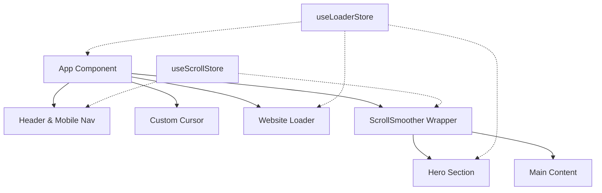

# Mohamed Magdy — Personal Portfolio

A modern, high-performance creative development portfolio engineered with React 19, Vite, Tailwind CSS v4, and GSAP 3. The application demonstrates advanced web animation patterns, inertial smooth scrolling, kinetic typography, and synchronized state management.

[](LICENSE)
[](https://react.dev/)
[](https://vitejs.dev/)
[](https://gsap.com/)
[](https://tailwindcss.com/)

---

## Overview

This repository houses the source code for the personal portfolio of Mohamed Magdy, a Frontend and Creative Developer based in Alexandria, Egypt. The project is designed with an engineering-first emphasis on visual fidelity, micro-interactions, and fluid timeline orchestration without sacrificing accessibility or runtime performance.

---

## Key Features

- **Kinetic Typography & Variable Fonts**: Dynamic letter-level animation using GSAP `SplitText` paired with interactive variable font variations (`wght`, `wdth`, `slnt`) responsive to pointer movement.
- **Physics-Based Magnetic Interactions**: Spring-damped elastic cursor tracking (`gsap.quickTo`) on primary call-to-action triggers and custom interactive cursors.
- **Inertial Smooth Scrolling**: Global scroll normalization via GSAP `ScrollSmoother` integrated with responsive mobile navigation freeze controls.
- **Sequenced Website Preloader**: Multi-phase reveal sequencing coordinating geometric card splits and scale expansion driven by central Zustand stores.
- **Reversible Navigation State Machine**: Scoped mobile navigation menu utilizing a single reversible GSAP timeline to prevent animation collisions and desync states.
- **Modern Theme Tokenization**: Fully configured Tailwind CSS v4 design token layer with custom color palettes (`charcoal`, `cream`, `accent`, `muted`) and typography pairings.

---

## Architecture & Tech Stack



### Core Technologies

| Component | Technology | Description |
| :--- | :--- | :--- |
| **Runtime & Framework** | React 19.2 | Core component architecture and concurrent rendering |
| **Build Tooling** | Vite 8.3 | High-speed ESM development server and Rollup production bundler |
| **Animation Engine** | GSAP 3.15 + `@gsap/react` | Timeline orchestration, `ScrollSmoother`, `ScrollTrigger`, and `SplitText` |
| **Styling** | Tailwind CSS v4.3 | Utility-first CSS engine with native theme variables |
| **State Management** | Zustand 5.0 | Lightweight, decoupled global reactive stores for loader and scroll handlers |
| **Routing** | React Router 8.4 | Client-side page navigation with Single Page Application rewrites |
| **Code Quality** | ESLint 10 | Strict linting rules with React Hooks and React Refresh configurations |

---

## Project Structure

```text
my-portfolio/
├── public/
│   ├── images/
│   └── favicon/               # Webmanifest and multi-resolution app icons
├── src/
│   ├── assets/
│   │   └── images/            # Static brand assets and logos
│   ├── components/
│   │   ├── animatedComponents/# ScrollSmoother and typography animators
│   │   ├── CustomCursor.jsx   # Custom pointer tracking component
│   │   ├── Header.jsx         # Navigation bar and animated mobile menu
│   │   ├── HeroSection.jsx    # Hero banner with kinetic typography and magnetics
│   │   ├── HorizontalSlider.jsx
│   │   ├── MainContent.jsx    # Primary portfolio sections container
│   │   └── WebsiteLoader.jsx  # Multi-stage introductory preloader
│   ├── Pages/
│   │   └── HomePage.jsx       # Root view composition
│   ├── store/
│   │   ├── useLoaderStore.js  # Global preloader progress and transition flags
│   │   └── useScrollStore.js  # ScrollSmoother reference registry
│   ├── styles/
│   │   └── App.css            # Tailwind theme tokens and root design variables
│   ├── utils/                 # Helper utilities and math functions
│   ├── App.jsx                # Application shell and lifecycle orchestration
│   ├── main.jsx               # React DOM entry point
│   └── gsap.config.js         # GSAP plugin registration layer
├── eslint.config.js           # Flat ESLint configuration
├── vercel.json                # SPA rewrite rules for production deployment
├── vite.config.js             # Vite configuration with Tailwind CSS plugin
└── package.json               # Manifest dependencies and run scripts
```

---

## Prerequisites

Ensure your local development environment meets the following minimum requirements:

- **Node.js**: `>= 18.0.0` (LTS recommended)
- **Package Manager**: `npm` (`>= 9.0.0`) or `pnpm` (`>= 8.0.0`)

---

## Getting Started

### 1. Clone the Repository

```bash
git clone https://github.com/mohamedmagdy-dev/my-portfolio.git
cd my-portfolio
```

### 2. Install Dependencies

```bash
npm install
```

### 3. Run Development Server

```bash
npm run dev
```

The application will be available at `http://localhost:5173`.

### 4. Build for Production

```bash
npm run build
```

Production artifacts will be generated in the `dist/` directory.

### 5. Preview Production Bundle

```bash
npm run preview
```

### 6. Linting

```bash
npm run lint
```

---

## Deployment

The application is optimized for deployment on **Vercel** or any static hosting platform supporting SPA routing. A `vercel.json` configuration is included to handle client-side routing rewrites:

```json
{
  "rewrites": [
    {
      "source": "/(.*)",
      "destination": "/index.html"
    }
  ]
}
```

---

## License

This project is licensed under the MIT License.
